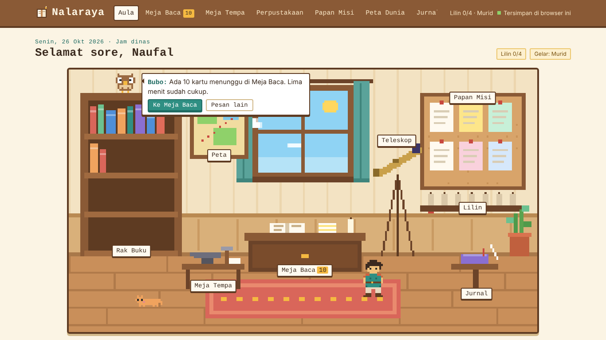
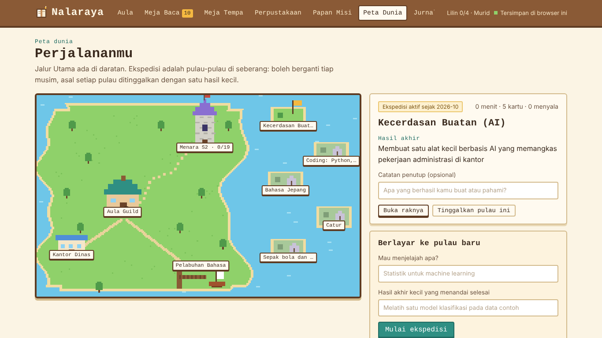

# Nalaraya

**Guild pustaka pribadi untuk belajar mandiri setiap hari.**

Nalaraya (*nalar* + *alaya*, "rumah bagi akal budi") adalah aplikasi belajar bergaya game pixel. Aplikasi ini dirancang untuk hari-hari yang melelahkan, bukan hari terbaik: tiga menit belajar tetap dihitung, dan setiap sesi disesuaikan dengan tenaga yang tersisa.



## Fitur

| Ruangan | Fungsi |
|---|---|
| **Aula Guild** | Ruangan pixel yang hidup. Setiap benda adalah pintu ke satu fitur; cahaya ruangan mengikuti jam asli (pagi, senja, malam). |
| **Gerbang Harian** | Pilih *Nyala Kecil / Sedang / Penuh* sesuai energi; aplikasi menyarankan satu hal saja untuk dikerjakan. |
| **Meja Baca** | Latihan mengingat dengan *spaced repetition* (algoritma bergaya SM-2) dan *interleaving* antar-rak. |
| **Meja Tempa** | Membuat kartu otomatis dari PDF, PowerPoint, Word, atau teks memakai AI; impor dari NotebookLM/Anki; paket kartu siap pakai. |
| **Papan Misi** | Quest jangka panjang (mis. persiapan S2) yang dipecah menjadi babak dan misi kecil. |
| **Peta Dunia** | Kemajuan quest digambarkan sebagai perjalanan ke menara; minat musiman menjadi pulau-pulau ekspedisi. |
| **Teleskop** | Konstelasi pengetahuan: kartu yang bertahan lebih dari 21 hari di ingatan menjadi bintang terang. |
| **Jurnal** | Riwayat sesi, analisis "jam emas" dari data sendiri, dan cadangan data. |

Karakter: petualang (avatar), **Bubo** si burung hantu pustakawan, dan **Kopi** si kucing guild. Semua digambar sebagai sprite pixel di Canvas.



## Teknologi

- **Frontend:** satu file `index.html`, HTML/CSS/JavaScript tanpa framework; pixel art digambar dengan Canvas 2D dari sprite berbasis teks.
- **Backend:** [Supabase](https://supabase.com) — Auth (tautan masuk lewat email), Postgres dengan *Row Level Security*, dan Edge Function untuk AI.
- **Pembaca file:** pdf.js (PDF) dan JSZip (PPTX/DOCX), dimuat hanya saat dibutuhkan.
- **Hosting:** GitHub Pages.

### Tiga mode penyimpanan

Kode yang sama berjalan di tiga tempat dan memilih penyimpanannya sendiri:

1. **Di Claude (artifact):** data tersimpan di akun Claude pemilik; Meja Tempa memakai Claude.
2. **Di GitHub Pages, pemilik sudah masuk:** data tersinkron di Supabase antar-perangkat; Meja Tempa memakai Edge Function.
3. **Di GitHub Pages, pengunjung:** *mode tamu* dengan data contoh yang hanya tersimpan di browser pengunjung.

## Menjalankan versi sendiri

### 1. Supabase

1. Buat project baru di Supabase (paket gratis cukup).
2. Buka **SQL Editor**, tempel isi `supabase/schema.sql`, lalu **Run**.
3. Di **Authentication**:
   - Pastikan login dengan **Email** aktif.
   - Matikan opsi pendaftaran pengguna baru (*Allow new users to sign up*), supaya pengunjung tidak bisa membuat akun.
   - Di **Users**, tambahkan satu pengguna dengan email kamu.
   - Di **URL Configuration**, isi *Site URL* dan *Redirect URLs* dengan alamat GitHub Pages-mu, mis. `https://username.github.io/nalaraya/`.
4. Di **Project Settings > API**, salin **Project URL** dan kunci **anon public**.

### 2. Isi konfigurasi

Buka `index.html`, cari `var CONFIG=`, lalu isi:

```js
var CONFIG={
  supabaseUrl:'https://xxxx.supabase.co',
  supabaseAnonKey:'eyJhbGciOi...'
};
```

Kunci *anon* memang boleh publik; datamu dilindungi oleh Row Level Security di `schema.sql`. **Jangan** pernah menaruh kunci *service_role* atau API key AI di `index.html`.

### 3. Meja Tempa (opsional)

Butuh [Supabase CLI](https://supabase.com/docs/guides/cli) dan API key AI milikmu sendiri.

```bash
supabase login
supabase link --project-ref KODE_PROJECT
supabase secrets set OWNER_EMAIL=emailkamu@contoh.com
supabase secrets set ANTHROPIC_API_KEY=sk-ant-...
# atau: supabase secrets set GEMINI_API_KEY=... GEMINI_MODEL=nama-model
supabase functions deploy tempa
```

Tanpa langkah ini aplikasi tetap berjalan; kartu bisa diisi lewat impor NotebookLM atau paket siap pakai.

### 4. GitHub Pages

1. Buat repo baru (mis. `nalaraya`) dan unggah semua file ini.
2. **Settings > Pages > Build and deployment**: pilih *Deploy from a branch*, cabang `main`, folder `/ (root)`.
3. Tunggu beberapa menit, lalu buka `https://username.github.io/nalaraya/`.

### 5. Pindahkan data dari versi Claude

Di versi Claude: **Jurnal > Cadangan > Unduh cadangan**. Di versi GitHub: masuk sebagai pemilik, lalu **Jurnal > Cadangan > Pulihkan dari file**.

### Mencoba di komputer sendiri

Tautan masuk tidak berjalan dari `file://`. Jalankan server lokal:

```bash
python -m http.server 8000
```

lalu buka `http://localhost:8000` (tambahkan juga alamat ini ke *Redirect URLs* Supabase bila ingin mencoba login).

## Struktur folder

```
nalaraya/
├── index.html                      aplikasi lengkap
├── supabase/
│   ├── schema.sql                  tabel + Row Level Security
│   └── functions/tempa/index.ts    Edge Function untuk Meja Tempa
└── docs/                           tangkapan layar untuk README
```

## Catatan desain

- **Rancang untuk hari terburuk.** Sesi 3 menit tetap menyalakan lilin; target mingguan (bukan harian) dan *Mode Bertahan* menurunkan target di musim sibuk.
- **Belajar aktif.** Latihan mengingat dan pengulangan berjarak, bukan membaca ulang.
- **Data milik sendiri.** Analisis jam belajar dihitung dari sesi yang tercatat, dan semua data bisa diunduh sebagai JSON.

---

Dibuat oleh Naufal sebagai proyek belajar dan portofolio.
